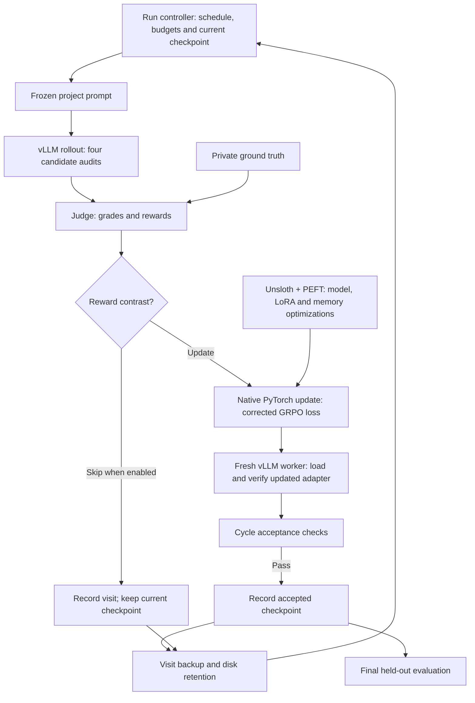

# Audit GRPO runtime

GRPO fine-tuning of `Qwen/Qwen3.8-27B` (LoRA) for smart-contract audit findings, with
an LLM judge grading each answer against private ground truth. Training runs on a
Linux/NVIDIA host with pinned Docker images; this repository holds the code, the
documents and selected evidence.

Rules for changing anything here are in [AGENTS.md](AGENTS.md).

## What the experiment measures

Whether training improves the model's **vulnerability detection and reasoning**. Output
format is not part of the question: answers are free text, no score depends on JSON,
Markdown or any layout, and evaluation never rejects an answer for its shape. The judge
extracts the claims a report makes and grades them against the ground truth.

The benchmark is the five Solidity repositories (munchables, vultisig, tigris, backd, phi;
`training-code/benchmark_scope.json`). Every evaluation runs all five, four draws per arm.
The Solidity 2 repositories (secondswap, renft, abracadabra) are extra verification only.

## How training works

This is a custom RL pipeline. Unsloth supplies model loading and training optimizations;
the repository owns the reward contract, corrected GRPO objective, optimizer loop,
checkpoint acceptance and orchestration. Generation runs separately in vLLM.

Each training visit samples four audits of one project from the current policy. The
judge grades them against private ground truth. When the rewards differ, the update
uses each answer's reward minus the group mean as its advantage, applies the clipped
policy objective with a correction for generation/training probability differences,
and takes one optimizer step. Only the LoRA adapter is trained; the BF16 base weights
stay frozen. Groups with equal rewards are skipped when the schedule enables that rule.



The diagram shows the successful update and configured skip paths. Failed phases follow
the bounded retry/skip policy described in the [training guide](training-code/README.md#resume-and-failures).
Private ground truth goes to grading only; policy inputs never contain it. Cycle
acceptance establishes update and transfer correctness; improvements in auditing
performance must be measured separately, by the held-out evaluation of the final checkpoint.

## Code architecture

All paths below are relative to `training-code/`. The detailed module inventory and
launch instructions live in its [README](training-code/README.md).

| Component | Implementation | Responsibility |
|---|---|---|
| Run orchestration | `launch-training.sh`, `controller.py`, `progress.py`, `schedules.py` | Choose visits, enforce the reviewed schedule, track the accepted policy and coordinate phases. |
| One training cycle | `launch-cycle.sh`, `cycle_contract.py` | Run rollout, grading, update and refresh; check evidence before accepting an update. |
| Policy inputs | `audited_corpus.py`, `frozen_requests.py`, `grpo/policy_prompt.py` | Build the corpus and freeze the prompt rendering and tokens used in training. |
| Generation and transfer | `inference/rollout.py`, `inference/adapter_compat.py` | Run vLLM, capture sampled tokens and log-probabilities, and verify the adapter loaded by inference workers. |
| Reward and judging | `grpo/judge_worker.py`, `grpo/reward.py`, `grpo/budget.py`, `grpo/judge_cache.py` | Grade candidates, enforce the reward contract and paid-call limits, and cache completed judging. |
| Policy update | `grpo/corrected_update.py`, `grpo/corrected_loss.py` | Calculate advantages and the corrected objective, backpropagate, and take the optimizer step. |
| Model execution | `grpo/native_policy.py`, `grpo/placement.py`, `grpo/memory_compat.py` | Load through Unsloth, attach PEFT adapters, place layers and manage memory/offloading. |
| Evaluation | `panels.py`, `inference/`, evaluation launchers | Run held-out comparisons separately from training rewards. |
| Recovery and storage | `hf_backup.py`, `retention.py`, `runtime_io.py`, `provenance.py` | Verify backups, retain checkpoints, manage disk space, write receipts and freeze source identity. |

The shell launchers sequence the work in containers; Python modules own the training
decisions and calculations. Result directories carry configs, samples, grades,
checkpoints and receipts between phases. The [host setup guide](HOST_SETUP.md) owns
images, mounts and host requirements; the [training guide](training-code/README.md#gpu-placement)
owns GPU placement settings. These are sequential phases within a visit, rather than
independent generation and training fleets running continuously.

## Relationship to larger RL systems

The RL algorithm and its execution framework are separate choices. DeepSeek's
[R1 report](https://arxiv.org/html/2501.12948v1) describes large-scale GRPO training.
Public systems such as [verl](https://github.com/verl-project/verl) combine distributed
training engines such as FSDP2 or Megatron with vLLM/SGLang generation;
[slime](https://github.com/THUDM/slime) connects Megatron and SGLang and documents use
in GLM post-training. These are public examples, not evidence of every lab's private
stack or a claim that labs never use Unsloth.

The shared structure is generation → reward → policy update → weight synchronization.
At cluster scale, the engineering expands to distributed model/optimizer state,
parallel generation, efficient weight transfer, worker recovery and, in some designs,
overlapping generation with training while controlling how stale samples may become.
Our pipeline implements that basic loop with a focus on fitting a frozen base plus
LoRA updates into a small GPU host.

Framework choice should follow measured constraints. Keep Unsloth while its memory
savings are useful and its execution is verified. A future Transformers/PEFT + FSDP2
comparison should hold prompts, sampled tokens, rewards and the objective fixed, then
compare numerical agreement, peak memory and throughput. Consider broader orchestration
frameworks when distributed execution and rollout scheduling justify the migration.

## Layout

| Path | Contents |
|---|---|
| `private/` | Operational state and experiment records (not in git). Start with `private/README.md`. |
| `training-code/` | The maintained code: launchers, controller, native update, judge, evaluation. See its [README](training-code/README.md). |
| `images/` | Dockerfile, locks and build script for the pinned runtime images. See [HOST_SETUP.md](HOST_SETUP.md). |
| `diagnostic-tools/`, `backup-tools/` | Standalone utilities: checkpoint merge and comparison, checkpoint backup. `merge_checkpoint.py` is called by `launch-training.sh`. |
| `archive/` | Finished-experiment code and the original extraction provenance. Read-only. |
| `results/` | Run configs, receipts, grades, model output and reports: dated evidence (not in git). |
| `workspace/` | Frozen backend snapshot used as `/workspace` (not in git). |
| `live-status.sh` | Containers, GPU memory and the newest run's accepted checkpoint. |
| `HOST_SETUP.md` | Preparing a new GPU host: requirements, restore from backup, images, checks. |
| `preflight.sh` | Checks a host against `HOST_SETUP.md` and names the step that fixes each failure. |

## Working on the code

```bash
cd training-code
bash run-tests-local.sh          # workstation: Docker + local deps image, no GPU or paid calls
bash run-tests.sh                # rental: pinned images
ruff check . && ruff format --check .
python3 provenance.py            # after any source or config change
```

Starting a training run, resume behavior and judge credentials are covered in
[training-code/README.md](training-code/README.md). Any GPU or paid work needs the
user's approval and a reviewed schedule (see AGENTS.md).

## Secrets

Credentials never live in the repository. Copy [.env.example](.env.example) to a
restricted file outside it and name that file in the run config (`judge_env_file`,
`hf_env_file`).

## Version control

This directory is a local git repository with no remote; the parent `ai-auditor`
repository ignores `backend/scripts/finetuning/`. [.gitignore](.gitignore) keeps out
secrets, `private/`, `results/`, `workspace/`, model weights and archives, and logs.
Check `git status --ignored` before any push.
